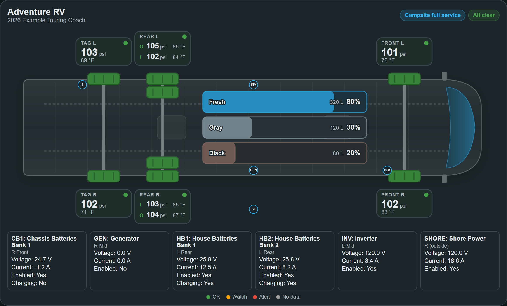
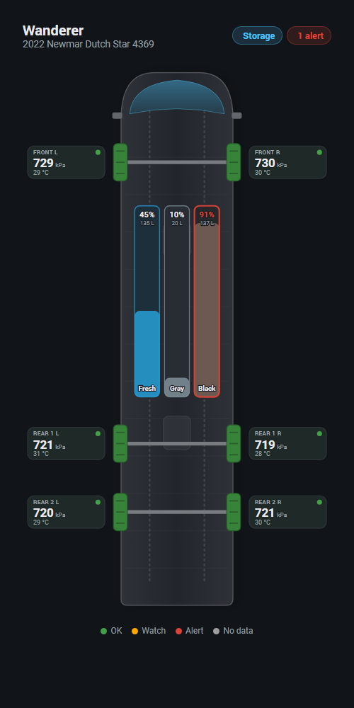
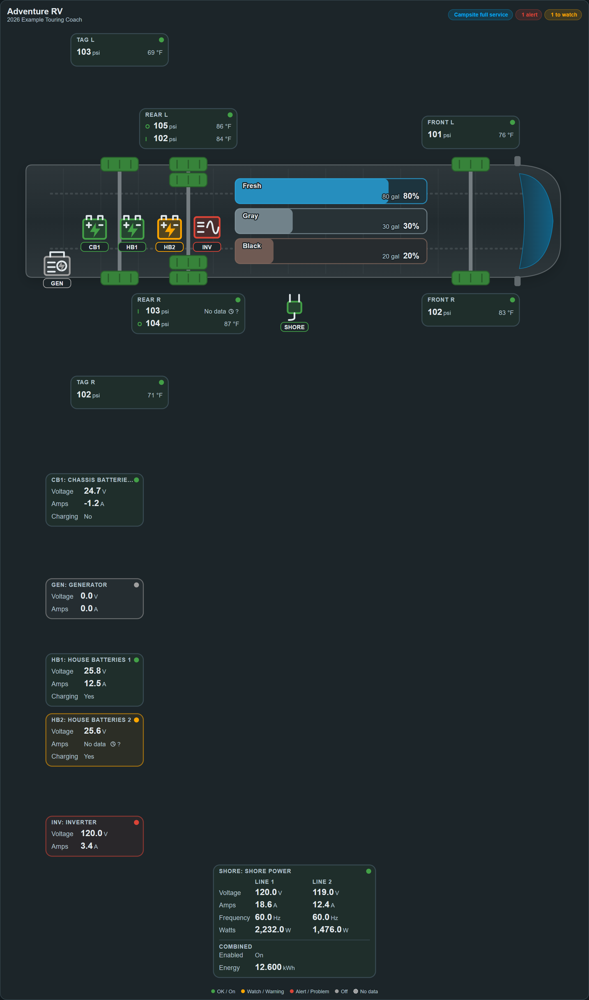
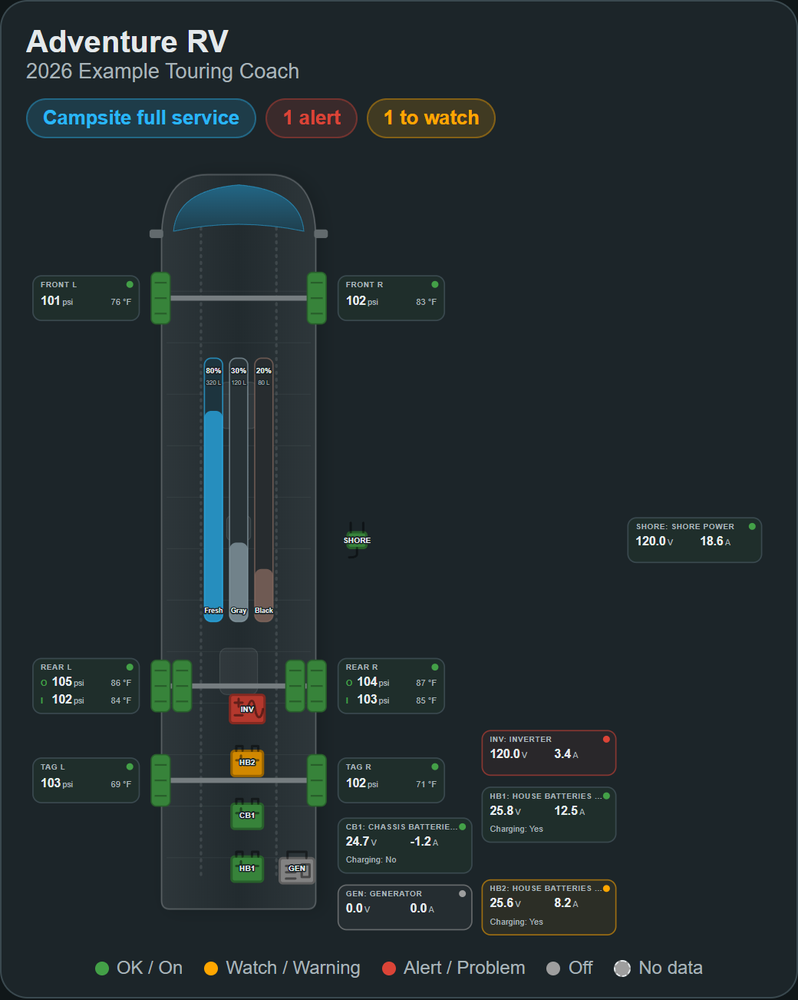

# HAVRV dashboard

The monitoring dashboard is separate from the management page opened by the
integration entry's gear. Configure profile layout and source mappings on that
page, then **Apply changes** to update the saved configuration used here.

HAVRV includes an RV overview card and a dashboard generated from your RV
profile. Both are installed with the integration. You do not need a separate
HACS frontend download or a Lovelace resource.



These rendered examples use synthetic source readings, not a particular RV's
specifications or wiring. Enabled, Charging, Warning, and Problem are
independently mapped; the example includes a battery warning and inverter problem.

The card draws your RV from above. It shows every configured wheel with its
pressure and temperature, and every configured water tank with its fill level.
The layout follows the RV profile:

- A front axle, then one to three rear axles, each with single or dual wheels.
- An optional tag axle, drawn behind the drive axles.
- Dual positions show outer (**O**) and inner (**I**) readings on one label.
- Pressure and temperature always share one line per tire, including single
  wheels. Labels grow for long readings and use outward lanes for crowded axles.
  Tight labels can omit the pressure unit or compact the temperature rather than
  moving it to a second line. Missing measurements show no data independently.
- Only the fresh, gray, and black water tanks that you configured are drawn.
  A capacity or level source defines a tank; thresholds alone do not. Clear
  both capacity and source and apply changes to remove it from the overview
  and generated tank sections. Configured tanks with unavailable sources stay
  visible as **No data**; empty leftover devices are ignored.
- Optionally placed house/chassis banks, Inverter and Generator have readout
  boxes beside their selected left/right front/mid/rear regions, like tire
  labels. Matching equipment tags identify the graphic and its box without
  crossing callout lines. Shore Power is outside the
  RV on the selected side. **HB1/CB1** identify bank 1, **INV** the logical
  inverter, **GEN** the generator, and **SHORE** the external shore connection.
  Each source retains its own box, including colocated banks. Boxes use nearby
  slots or additional outward lanes to avoid other boxes and tire labels;
  the drawing expands to keep every box visible. Mapped voltage, current,
  Bank Charging appears inside the box. Enabled is shown through the overall
  tint and status dot, not a redundant Yes/No row. A status dot in its title
  reflects Enabled/Warning/Problem, just like the tire-label dots.
  Separate battery, generator, inverter and plug graphics show the equipment
  itself on the coach; the shore plug is outside. Each bank has its own graphic.
  Select a reading or use Tab and Enter/Space to open its details.
- Shore Power's box labels the mapped **Line 1** and **Line 2** voltage, amps,
  frequency and watts, followed by one shared **Energy** reading in kWh.
  Only mapped readings appear, and an unavailable reading does not hide other
  readings. Larger boxes reserve enough space in both orientations without
  overlapping other equipment. Generated Shore Power sections include the
  same sensors. Energy resets are performed on the underlying meter, not from
  a HAVRV dashboard button. `show_power: false` hides these readings along
  with the other power sources.
- Wide cards draw the RV horizontally, with the front on the right. Cards
  narrower than about 560 pixels, such as on phones, draw it vertically with
  the front at the top.
- The drawing keeps a readable minimum size, rather than squeezing a crowded
  diagram into the card. Small cards scroll horizontally when necessary; tall
  drawings scroll vertically within an 80%-of-viewport-height region. Tab to the
  diagram region to scroll with the keyboard. The same card works in small or
  large dashboard sections, in either orientation.



## Configure electrical placement on an existing RV

1. Open **Settings → Devices & services → HAVRV** and the RV entry's
   **Configure/Options** action.
2. Select **Edit power-source mappings, specifications and placement** on
   the initial options form, then submit.
3. Set **Dashboard placement** on each bank, Inverter, Generator, and Shore
   Power screen. Choose one of the six interior regions; shore uses left/right
   outside. Left/right are viewed facing forward.
4. Submit every screen to save. Cancelling the wizard leaves prior settings
   unchanged. **Reconfigure** changes bank counts, not placement.

Placement defaults to **Not shown**. The overview only draws placed sources;
the generated dashboard can still include unplaced source-device sections.
Colocated devices retain separate, nonoverlapping boxes associated with the same
region. You do not enter physical positions in dashboard YAML.

The card's visual editor has toggles for **tires and tire analysis**, **tanks**,
**placed power sources**, **coach information and operation mode**, and **mapped
system sections**, alongside **header** and **legend**. Every toggle defaults
to on. Coach/system sections apply to the generated dashboard; hiding coach
information also removes the overview subtitle and operation-mode pill, not the
RV silhouette or name. If these toggles are absent, the browser has
an older module: update/restart HAVRV, remove any old manually added HAVRV
dashboard resource, and reset the browser/app cache. See the
[troubleshooting steps](TROUBLESHOOTING.md#the-power-toggle-or-placed-electrical-devices-are-missing).

Readings use the units shown by the HAVRV entities, so they follow your RV
profile's measurement system and any unit you set on an entity. Select a wheel,
tank, or the operation mode to open its details.

## Status colors

Colors come from the HAVRV problem and trend entities. The card does not apply
its own limits.

| Color | Tires | Tanks |
| --- | --- | --- |
| Green | Pressure reading available and no problem reported | **Tank status** is OK |
| Amber (watch) | **Slow pressure loss** or **Battery problem** is on | **Tank status** is Warning |
| Red (alert) | **Sudden pressure drop**, **Pressure problem**, or **Temperature problem** is on | **Tank status** is Problem |
| Gray (no data) | No pressure reading | No percentage reading |

A wheel with a pressure reading but no temperature or battery source is still
shown as green. Tire labels also show **▼** for a pressure-loss trend, **HOT**
for a temperature problem, and **BAT** for a low sensor battery. On dual-wheel
labels, **▼** and **BAT** appear beside the label's title, and a temperature
problem colors that wheel's temperature red. If a dual-wheel label is too
narrow for its readings, the pressure unit is left out for that label.

The header shows the RV name, its year, manufacturer, and model, the operation
mode, and counts of alerts, items to watch, and readings with no data.
Only visible tires, tanks and placed electrical sources contribute to these
counts. Hiding a class also removes its layout reservations and setup hints;
it does not change the RV profile, entities, monitoring, or source readings.

### Placement stress example

These synthetic examples put Generator, Inverter, CB1, HB1 **and HB2** at
**R-Rear**, with Shore Power on **R** outside. Shore currently accepts a side,
not front/mid/rear; it remains centered on that outside side.

Each device keeps an independent tagged graphic and readout. Equipment uses
additional interior slots around the rear region, avoiding tires and tanks.
Readouts try neighboring slots first, then additional outward rows/columns;
the drawing expands instead of overlapping or clipping them. A crowded region
therefore takes more space. Matching tags replace connecting lines.





### Electrical box colors

Optionally map **Warning** and **Problem** on each power-source options screen.
These accept `binary_sensor`, `switch`, or `input_boolean`, just like Enabled;
they are read-only. HAVRV does not derive them from voltage or current.

| Box | Meaning |
| --- | --- |
| Red dot/tint / Problem | Mapped Problem is `on`, regardless of Warning or Enabled |
| Amber dot/tint / Warning | Mapped Warning is `on` and no known Problem is on |
| Green dot/tint / On | Enabled is `on` and mapped alerts are definitely off |
| Gray dot/tint / Off | Enabled is `off` and mapped alerts are definitely off |
| Dashed gray box and hollow dot / No status data | No Enabled mapping, or an applicable mapped status is missing, unknown, or unavailable |

Unmapped Warning/Problem do not require data and do not create inferred alarms.
A known active Problem or Warning still appears when another status has no data.
Otherwise an unavailable mapped alert prevents a normal green/gray status, even
if Enabled is known. Charging remains independent. Electrical statuses have
a common legend with tires and tanks, status tooltips and accessible labels, plus a dashed
no-data outline. Select the status dot to open the applicable mapped entity.
Warning and Problem remain available in the generated source-device sections.

Electrical boxes share the tire labels' 7% tinted background, translucent
border, theme-aware text, header style, and font sizes. Voltage/current use
the dual-tire reading style, with smaller units and secondary status readings.
Problem outlines pulse like tire alerts, respecting reduced-motion settings.
Equipment graphics use the tire shapes' color treatment: **green** for known
Enabled on, **gray** for off, **amber** for Warning and **red** for Problem.
Unknown status has a dashed unfilled graphic. The readout's normal on dot/tint
is green too. Charging does not select an active source or override
these statuses.

Graphics avoid tires, tanks and each other. They use a 44-unit footprint,
comparable to the tire shapes rather than tiny markers. Matching **HB1**, **CB1**,
**INV**, **GEN**, and **SHORE** tags associate equipment and readouts with no
callout lines crossing labels. Very dense bank configurations use outward
overflow lanes once the coach is full, instead of shrinking graphics to
unreadable sizes; boxes remain separate. These symbols are placement illustrations, not a wiring
diagram or equipment dimensions. Select a graphic to open its mapped status
(or its reading when no status is mapped).

Placed electrical Problems and Warnings contribute to the header's alert/watch
counts. Missing mapped statuses count as no data, not alarms. Unplaced sources
and electrical sources hidden with `show_power: false` do not contribute.

## Create the RV dashboard

1. Go to **Settings → Dashboards** and select **Add dashboard**.
2. Choose **New dashboard from scratch** and give it a name, such as **RV**.
3. Open the new dashboard, select the pencil icon, then the three-dot menu, and
   choose **Raw configuration editor**.
4. Replace the contents with:

   ```yaml
   strategy:
     type: custom:havrv
     show_power: true
   ```

5. Save and close the editor.

The dashboard creates one view for each RV profile. Each view contains:

- The RV overview card.
- **Coach**: the operation-mode selector and the RV profile sensors.
- **Tanks**: fill percentage and the last filled or emptied time for each tank.
- **Tire analysis**: All Tire Monitor comparisons, when tires are configured.
- One section for each system device with mapped entities.
- Individual power-source sections, including configured nominal bank
  specifications and read-only statuses. Sources without physical placement
  still appear here. Set `show_power: false` on the strategy to omit these
  sections and overview electrical boxes.

Enabled is not active supply, and Charging is shown only from an explicit bank
source. Neither status creates an inferred electrical warning/problem or
power-flow arrows. Equipment tags indicate placement and identity, not wiring.

The single common legend uses **OK / On**, **Watch / Warning**, **Alert / Problem**,
**Off**, and **No data** when electrical sources are shown. Gray Off is distinct
from the hollow/dashed No data indicator. With electrical hidden, the legend
retains the tire/tank labels.

The dashboard updates itself when you change the RV profile, add tanks, or map
entities. To customize it, open the dashboard's three-dot menu and choose
**Take control**. This converts the generated layout into a regular dashboard
that no longer updates itself.

### Reuse driving and parked layouts

Dashboard and view strategies accept the same `layout` and `show_*` options as
the card and pass them to each overview. `show_tanks` also hides the tank section,
`show_tires` hides Tire analysis, `show_coach` hides Coach, and `show_systems`
hides existing mapped-system sections. No per-system or future-system options
are required.

These are presentation presets, **not** automatic reactions to the operation
mode. Use whichever view suits your current task. For example, the following
uses YAML anchors to reuse compact driving/parked configurations in wide views.
Replace the device ID with yours. All omitted visibility flags remain `true`.

```yaml
views:
  - title: Driving compact
    path: driving-compact
    strategy: &driving
      type: custom:havrv
      device_id: &rv 0123456789abcdef0123456789abcdef
      layout: vertical
      show_tanks: false
      show_power: false
      show_coach: false
      show_systems: false
      show_header: false
      show_legend: false
  - title: Driving wide
    path: driving-wide
    strategy:
      <<: *driving
      layout: horizontal
      show_header: true
      show_legend: true
  - title: Parked compact
    path: parked-compact
    strategy: &parked
      type: custom:havrv
      device_id: *rv
      layout: vertical
      show_tires: false
      show_coach: false
      show_systems: false
      show_header: false
      show_legend: false
  - title: Parked wide
    path: parked-wide
    strategy:
      <<: *parked
      layout: horizontal
      show_coach: true
      show_systems: true
      show_header: true
      show_legend: true
```

For a single view that changes orientation with its available width, use
`layout: auto`. In a standalone card, use the same visibility/layout options with
`type: custom:havrv-rv-card`; no new systems are created by these presets.

### Add an RV view to an existing dashboard

Add a view with the view strategy. Set `device_id` to the RV device, or to any
of its HAVRV devices, to choose the RV when you have more than one profile.

```yaml
views:
  - title: RV
    path: rv
    icon: mdi:rv-truck
    strategy:
      type: custom:havrv
      device_id: 0123456789abcdef0123456789abcdef
      show_power: true
```

To find a device ID, open the device in **Settings → Devices & services**. The
ID is the last part of the page address.

## Add the card to any dashboard

In dashboard edit mode, select **Add card** and search for
**HAVRV RV overview**. The visual editor offers these options:

| Option | Default | Description |
| --- | --- | --- |
| `device_id` | First RV profile | The RV device, or any of its HAVRV devices |
| `layout` | `auto` | `auto`, `horizontal`, or `vertical` |
| `show_header` | `true` | Show the name, operation mode, and status summary |
| `show_legend` | `true` | Show the status color legend |
| `show_power` | `true` | Show individually placed power-source readout boxes |
| `show_tires` | `true` | Show tire shapes/readouts; also Tire analysis on strategies |
| `show_tanks` | `true` | Show tank shapes/readouts; also Tanks on strategies |
| `show_coach` | `true` | Show coach subtitle and operation-mode pill; also Coach on strategies |
| `show_systems` | `true` | Show existing mapped-system sections on strategies (no extra overview graphics) |

```yaml
type: custom:havrv-rv-card
device_id: 0123456789abcdef0123456789abcdef
layout: auto
show_power: true
```

In a sections view, the card spans the full width of its section.
Every `show_*` option defaults to `true`, including for older dashboards that
omit these keys. Explicit `false` hides that class. `show_power` enables placed
electrical boxes on the card, and also electrical-device sections when used on a strategy. There is
no separate electrical strategy. If you previously selected **Take control**,
your static dashboard does not automatically gain new generated sections; add
the current card or a strategy view without replacing other views.

## How the layout is found

The card reads the Home Assistant device and entity registries. HAVRV device
identifiers name each tire position and tank, and entity translation keys
identify each reading, so renamed entity IDs and devices still work. Entities
you hide are left out of the generated dashboard sections, but tire and tank
readings stay on the card.
Power-source identities encode the bank/device, while a diagnostic placement
sensor supplies its region. No source entity names or RV-specific wiring are
assumed.

The tire problem and trend states are advisory. Follow the vehicle and tire
manufacturers' guidance.
